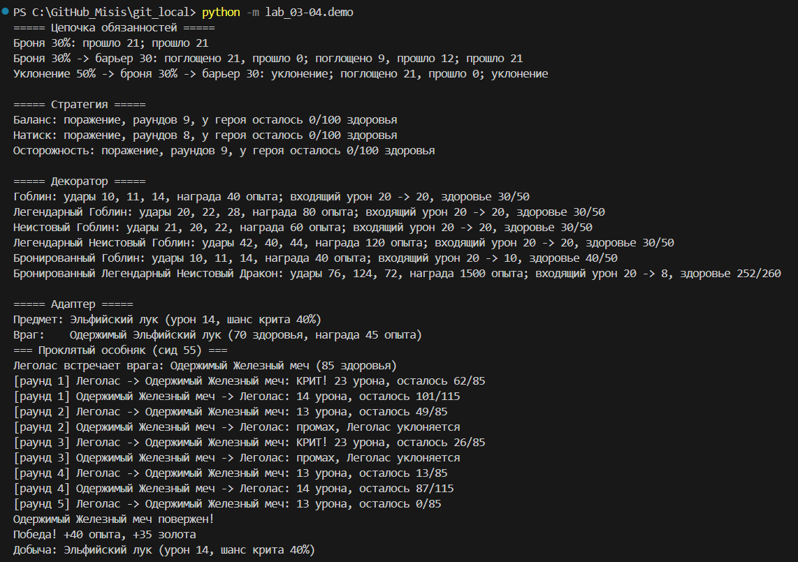
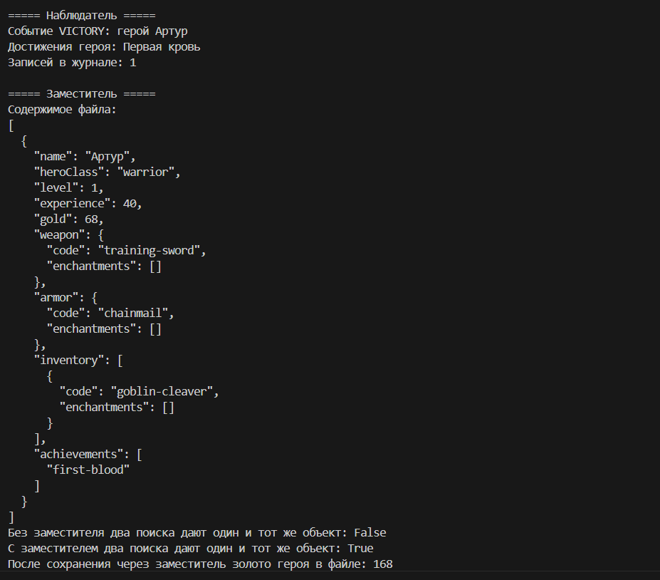
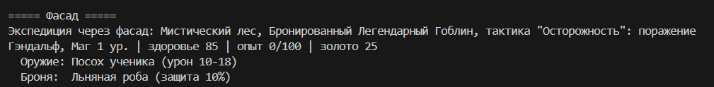

# Репозиторий для Лаб (опять)

# Лаба 1
# Ну пока это изяка...

ПРИВЕТ!!! :), Балуюсь, пишу тут текста многааааа...

ФИО: Машков Василий Сергеевич  /// ГРУППА: БИВТ-25-4-3

# Лаба 2
# Сильно посложнее...

```python
from abc import ABC, abstractmethod

#Интерфейс Pet
class Pet(ABC):
    @abstractmethod
    def express(self):
        pass
    @abstractmethod
    def getName(self) -> str:
        pass
    @abstractmethod
    def getAge(self) -> int:
        pass
    @abstractmethod
    def getAgeInHumanYears(self) -> int:
        pass


#Абстрактный класс Animal
class Animal(Pet, ABC):
    def __init__(self, name: str, age: int):
        self._name = name
        self._age = age
    def happyBirthday(self):
        self_age += 1
    def getName(self) -> str:
        return self._name
    def getAge(self) -> int:
        return self._age

    @abstractmethod
    def express(self):
        pass
    @abstractmethod
    def getAgeInHumanYears(self) -> int:
        pass


#Класс Parrot
class Parrot(Animal):
    def express(self):
        return f'{self.getName()}: "ПРИВЕТ!"'
    def getAgeInHumanYears(self) -> int:
        #1 год попугая = 5 человеческим
        return self.getAge() * 5


#Класс Turtle
class Turtle(Animal):
    def express(self):
        return f'{self.getName()}: "И ЧТО МНЕ ТУТ ПИСАТЬ, ЧЕРЕПАХИ НЕ РАЗГОВАРИВАЮТ..."'
    def getAgeInHumanYears(self) -> int:
        #1 год черепахи = 5.25 человеческим (как в примере 4 -> 21)
        return int(self.getAge() * 5.25)


#Класс Person
class Person:
    def __init__(self, name: str, pet: Pet = None):
        self._name = name
        self._pet = pet
    def setPet(self, pet: Pet):
        self._pet = pet
    
    def getPetInfo(self):
        print("-----------------------")
        if self._pet is None:
            print(f"{self._name} пока без питомца")
        else:
            print(f"Питомца у {self._name} зовут {self._pet.getName()}")
            print(f"Возраст: {self._pet.getAge()} года, около {self._pet.getAgeInHumanYears()} человеческих лет")
            print("И он говорит типо:")
            print(self._pet.express())
        print("-----------------------")


#Основная программа
if __name__ == "__main__":
    
    #Создаем людей
    jack = Person("Jack")
    john = Person("John")

    #Создаем питомцев
    kesha = Parrot("Kesha", 3)
    zavala = Turtle("Zavala", 4)

    #Привязываем питомцев
    jack.setPet(kesha)

    #Вызываем метод для Джека с питомцем
    jack.getPetInfo()

    #Вызываем метод для Джона без питомца
    john.getPetInfo()

    #Привязываем питомца Джону и снова вызываем
    john.setPet(zavala)
    john.getPetInfo()
```

# Что выводит?


# Лабы 3–4
# Ну тут уже настоящая RPG :)

RPG: создаём героя, ходим в экспедиции, сражаемся с врагами и получаем опыт, золото и добычу. В лагере можно поменять снаряжение и торговать. В четвёртой лабе есть тактики, усиленные враги, достижения и сохранения.

# Запуск

```bash
python -m lab_03-04.main   # сама игра
python -m lab_03-04.demo   # демонстрация семи паттернов из лабы 4
```

# Паттерны

## Лаба 3 — порождающие

- **Одиночка** — `core/dice.py`: одна общая кость для случайных событий.
- **Прототип** — `item/item.py`, `item/item_catalog.py`: предметы создаются как копии шаблонов.
- **Абстрактная фабрика** — `kit/`: у каждого класса героя свой набор стартового снаряжения.
- **Строитель** — `hero/hero.py`: герой собирается через `Hero.Builder`.
- **Фабричный метод** — `world/location.py` и конкретные локации: каждая локация создаёт своего врага.

## Лаба 4 — структурные

- **Адаптер** — `enemy/haunted_weapon.py`: превращает оружие в противника для проклятого особняка.
- **Декоратор** — `enemy/enemy_decorator.py` и декораторы врагов: добавляют усиления и позволяют их комбинировать.
- **Заместитель** — `storage/caching_hero_repository.py`: кэширует героев и обращается к файловому хранилищу для сохранения.
- **Фасад** — `game/game_facade.py`: связывает локации, героев, торговца, сохранения и события, чтобы консоль работала с игрой проще.

## Лаба 4 — поведенческие

- **Стратегия** — `tactic/`: разные способы поведения героя в бою.
- **Наблюдатель** — `event/` и `progress/`: события экспедиций обрабатывают достижения и журнал.
- **Цепочка обязанностей** — `defense/`: входящий урон проходит через подходящие обработчики защиты.

# Структура

Все папки и файлы ниже находятся в `lab_03-04/`:

- `core/` — кость `Dice` (одиночка)
- `combat/` — боевая механика
- `item/` — предметы и каталог (прототип)
- `kit/` — стартовое снаряжение (абстрактная фабрика)
- `hero/` — герой и его классы (строитель)
- `enemy/` — враги, одержимое оружие и усиления
- `world/` — локации и экспедиции (фабричный метод)
- `camp/` — торговец
- `defense/` — уклонение, броня и барьер
- `tactic/` — тактики боя
- `event/` — игровые события и подписчики
- `progress/` — достижения и журнал экспедиций
- `storage/` — сохранения и их кэширование
- `game/` — фасад игры
- `console_view.py` — весь вывод в консоль
- `main.py` — игра, `demo.py` — демонстрация паттернов

# Что выводит? (скрины в demo.py)



