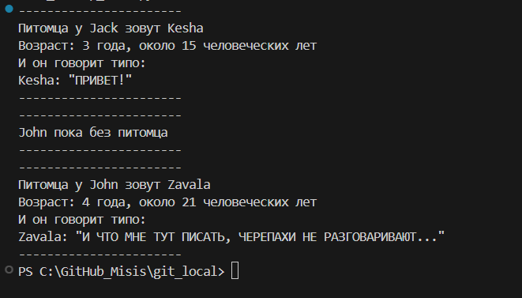

# Репозиторий для Лаб (опять)

# Лаба 1
# Ну пока это изяка...

ПРИВЕТ!!! :), Балуюсь, пишу тут текста многааааа...

ФИО: Машков Василий Сергеевич  /// ГРУППА: БИВТ-25-4-3

# Лаба 2
# Сильно посложнее...

```python
from abc import ABC, abstractmethod

#Интерфейс Pet
class Pet(ABC):
    @abstractmethod
    def express(self):
        pass
    @abstractmethod
    def getName(self) -> str:
        pass
    @abstractmethod
    def getAge(self) -> int:
        pass
    @abstractmethod
    def getAgeInHumanYears(self) -> int:
        pass


#Абстрактный класс Animal
class Animal(Pet, ABC):
    def __init__(self, name: str, age: int):
        self._name = name
        self._age = age
    def happyBirthday(self):
        self_age += 1
    def getName(self) -> str:
        return self._name
    def getAge(self) -> int:
        return self._age

    @abstractmethod
    def express(self):
        pass
    @abstractmethod
    def getAgeInHumanYears(self) -> int:
        pass


#Класс Parrot
class Parrot(Animal):
    def express(self):
        return f'{self.getName()}: "ПРИВЕТ!"'
    def getAgeInHumanYears(self) -> int:
        #1 год попугая = 5 человеческим
        return self.getAge() * 5


#Класс Turtle
class Turtle(Animal):
    def express(self):
        return f'{self.getName()}: "И ЧТО МНЕ ТУТ ПИСАТЬ, ЧЕРЕПАХИ НЕ РАЗГОВАРИВАЮТ..."'
    def getAgeInHumanYears(self) -> int:
        #1 год черепахи = 5.25 человеческим (как в примере 4 -> 21)
        return int(self.getAge() * 5.25)


#Класс Person
class Person:
    def __init__(self, name: str, pet: Pet = None):
        self._name = name
        self._pet = pet
    def setPet(self, pet: Pet):
        self._pet = pet
    
    def getPetInfo(self):
        print("-----------------------")
        if self._pet is None:
            print(f"{self._name} пока без питомца")
        else:
            print(f"Питомца у {self._name} зовут {self._pet.getName()}")
            print(f"Возраст: {self._pet.getAge()} года, около {self._pet.getAgeInHumanYears()} человеческих лет")
            print("И он говорит типо:")
            print(self._pet.express())
        print("-----------------------")


#Основная программа
if __name__ == "__main__":
    
    #Создаем людей
    jack = Person("Jack")
    john = Person("John")

    #Создаем питомцев
    kesha = Parrot("Kesha", 3)
    zavala = Turtle("Zavala", 4)

    #Привязываем питомцев
    jack.setPet(kesha)

    #Вызываем метод для Джека с питомцем
    jack.getPetInfo()

    #Вызываем метод для Джона без питомца
    john.getPetInfo()

    #Привязываем питомца Джону и снова вызываем
    john.setPet(zavala)
    john.getPetInfo()
```

# Что выводит?


# Лабораторная работа 3 — порождающие шаблоны проектирования

Текстовая RPG: герой ходит в экспедиции, сражается с врагами, получает опыт, золото и добычу.

# Запуск

Из корня репозитория:

```
python -m lab_03.demo   # показать все 5 паттернов
python -m lab_03.main   # сама игра
```

Если русский текст отображается неверно — сначала выполни `chcp 65001`.

# Паттерны

| Паттерн | Где |
| Одиночка | `core/dice.py` |
| Прототип | `item/item.py`, `item/item_catalog.py` |
| Абстрактная фабрика | `kit/` |
| Строитель | `hero/hero.py` |
| Фабричный метод | `world/location.py` + `forest.py`, `crypt.py`, `dragon_lair.py` |

# Структура

- `core/` — кость `Dice` (одиночка) и общее исключение
- `combat/` — боевая механика
- `item/` — предметы и каталог-прототип
- `kit/` — стартовое снаряжение (абстрактная фабрика)
- `hero/` — герой и строитель
- `enemy/` — враги
- `world/` — локации (фабричный метод)
- `camp/` — торговец
- `console_view.py` — весь вывод в консоль
- `main.py` — игра, `demo.py` — демонстрация паттернов